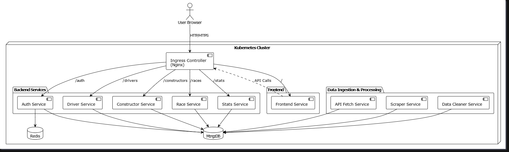

# 🏎️ RaceMetrics - Formula 1 Data Analytics Platform

A comprehensive, containerized F1 analytics system that collects, analyzes, and visualizes Formula 1 race data using Flask microservices, MongoDB, React, and Kubernetes.



## 🎯 Features

- **Real-time F1 Data Collection**: Fetches data from Ergast API
- **Web Scraping**: Additional data from Formula1.com and BBC Sport
- **Advanced Analytics**: Driver consistency, constructor performance, race pace analysis
- **Modern UI**: Beautiful React dashboard with interactive charts
- **Microservices Architecture**: Scalable containerized services
- **Authentication**: JWT-based user authentication
- **Data Visualization**: Interactive charts and statistics
- **Kubernetes Ready**: Production-ready K8s manifests included

## 🏗️ Architecture

### Microservices

1. **Auth Service** - JWT-based authentication and user management
2. **API Fetch Service** - Ergast API data collection
3. **Scraper Service** - Additional F1 data scraping
4. **Data Cleaner Service** - Data standardization and cleaning
5. **Driver Service** - Driver management and statistics
6. **Constructor Service** - Team data and performance
7. **Race Service** - Race results and analysis
8. **Stats Service** - Advanced analytics calculations
9. **Frontend Service** - React dashboard
10. **MongoDB** - Central database
11. **Redis** - Caching layer (optional)
12. **Nginx** - Reverse proxy and load balancer

### Tech Stack

- **Backend**: Flask (Python 3.9+)
- **Frontend**: React 18 with Styled Components
- **Database**: MongoDB 6.0
- **Cache**: Redis (optional)
- **External API**: Ergast API (Free F1 data)
- **Web Scraping**: BeautifulSoup4
- **Orchestration**: Docker Compose / Kubernetes
- **Reverse Proxy**: Nginx
- **Charts**: Recharts

## 🚀 Quick Start

### Prerequisites

- Docker and Docker Compose (for local development)
- Kubernetes cluster (for production deployment)
- Git

### Local Development with Docker Compose

1. **Clone the repository**
   ```bash
   git clone https://github.com/syedkhadeen/Kubernetes.git
   cd Kubernetes
   ```

2. **Set up environment variables**
   ```bash
   cp .env.example .env
   # Edit .env and set JWT_SECRET to a strong random value
   # Generate one with: openssl rand -hex 32
   ```

3. **Start the services**
   ```bash
   docker-compose up --build
   ```

4. **Access the application**
   - Frontend: http://localhost:3000
   - API Gateway: http://localhost:80

### Production Deployment with Kubernetes

See the [Kubernetes Deployment Guide](k8s/README.md) for detailed instructions.

Quick steps:
```bash
# 1. Update secrets
cp k8s/.env.example k8s/.env
# Edit k8s/.env and set your JWT_SECRET

# 2. Apply manifests
kubectl apply -f k8s/namespace.yaml
kubectl apply -f k8s/configmap-secret.yaml
kubectl apply -f k8s/mongo-statefulset.yaml
kubectl apply -f k8s/redis-deployment.yaml
kubectl apply -f k8s/backend-deployments.yaml
kubectl apply -f k8s/backend-services.yaml
kubectl apply -f k8s/frontend-deployment.yaml
kubectl apply -f k8s/ingress.yaml
```

## 📊 API Endpoints

### Auth Service (Port 5001)
- `POST /register` - User registration
- `POST /login` - User login
- `GET /profile` - Get user profile (requires auth)
- `POST /validate-token` - Validate JWT token

### API Fetch Service (Port 5002)
- `GET /fetch/latest` - Fetch latest season data
- `GET /fetch/drivers` - Fetch all drivers
- `GET /fetch/constructors` - Fetch all constructors
- `GET /fetch/standings/{year}` - Fetch standings for a year

### Scraper Service (Port 5003)
- `GET /scrape/news` - Scrape F1 news
- `GET /scrape/latest` - Scrape latest data
- `GET /scrape/all/{year}/{round}` - Scrape all race data

### Data Cleaner Service (Port 5004)
- `POST /clean/all` - Clean all data
- `POST /clean/drivers` - Clean driver data
- `POST /clean/constructors` - Clean constructor data

### Driver Service (Port 5005)
- `GET /drivers` - Get all drivers
- `GET /drivers/{id}` - Get specific driver
- `GET /drivers/top` - Get top drivers
- `GET /drivers/{id}/stats` - Get driver statistics

### Constructor Service (Port 5006)
- `GET /constructors` - Get all constructors
- `GET /constructors/{id}` - Get specific constructor
- `GET /constructors/rankings` - Get constructor rankings

### Race Service (Port 5007)
- `GET /races` - Get all races
- `GET /races/{season}/{round}` - Get specific race
- `GET /races/latest` - Get latest race
- `GET /races/{season}/{round}/results` - Get race results

### Stats Service (Port 5008)
- `GET /stats/fastest-lap` - Get fastest lap statistics
- `GET /stats/podium-frequency` - Get podium frequency
- `GET /stats/driver-consistency/{id}` - Get driver consistency
- `GET /stats/season-trends/{year}` - Get season trends

## 🎨 Frontend Features

- **Dashboard**: Real-time statistics overview with KPIs
- **Driver Analytics**: Performance trends and consistency analysis
- **Constructor Analytics**: Team performance metrics
- **Race Analysis**: Detailed race results and circuit information
- **Advanced Statistics**: Fastest laps, podium frequency, championship progressions

## 🔧 Development

### Project Structure

```
racemetrics/
├── docker-compose.yml          # Docker Compose configuration
├── .env.example                # Environment variables template
├── k8s/                        # Kubernetes manifests
│   ├── namespace.yaml
│   ├── configmap-secret.yaml
│   ├── backend-deployments.yaml
│   ├── backend-services.yaml
│   ├── frontend-deployment.yaml
│   ├── ingress.yaml
│   ├── mongo-statefulset.yaml
│   ├── redis-deployment.yaml
│   └── README.md
├── nginx/                      # Nginx configuration
│   └── nginx.conf
├── auth-service/               # Authentication microservice
├── api-fetch-service/          # API data fetching service
├── scraper-service/            # Web scraping service
├── data-cleaner-service/       # Data cleaning service
├── driver-service/             # Driver management service
├── constructor-service/        # Constructor management service
├── race-service/               # Race management service
├── stats-service/              # Statistics service
└── frontend-service/           # React frontend
    ├── src/
    ├── public/
    └── package.json
```

### Initial Data Setup

After starting the services, populate the database:

```bash
# 1. Fetch current season data
curl -X GET http://localhost:5002/fetch/latest

# 2. Scrape additional data
curl -X GET http://localhost:5003/scrape/latest

# 3. Clean and process data
curl -X POST http://localhost:5004/clean/all
```

### Environment Variables

Key environment variables (see `.env.example`):

```bash
# REQUIRED: JWT Secret for authentication
JWT_SECRET=your-super-secret-jwt-key-change-in-production

# Database connection
MONGO_URI=mongodb://mongo:27017/racemetrics

# Frontend API URLs
REACT_APP_API_BASE_URL=http://localhost
REACT_APP_AUTH_SERVICE_URL=http://localhost:5001
# ... (see .env.example for complete list)
```

## 🔒 Security

### Production Checklist

- [ ] Generate a strong JWT_SECRET (use `openssl rand -hex 32`)
- [ ] Update all secrets in `k8s/configmap-secret.yaml`
- [ ] Enable HTTPS/TLS in production
- [ ] Configure proper CORS settings
- [ ] Set up MongoDB authentication
- [ ] Use Kubernetes secrets for sensitive data
- [ ] Enable network policies
- [ ] Set resource limits and requests
- [ ] Configure proper logging and monitoring
- [ ] Regular security updates for dependencies

### Generating Secrets

```bash
# Generate a strong JWT secret
openssl rand -hex 32

# Or use Python
python -c "import secrets; print(secrets.token_hex(32))"
```

## 📈 Performance & Monitoring

### Health Checks
All services include health check endpoints:
```bash
curl http://localhost:5001/health
```

### Logging
- Structured logging with timestamps
- Error tracking and debugging
- Performance monitoring

### Scaling

**Horizontal Scaling** (Kubernetes):
```bash
kubectl scale deployment auth-service --replicas=3 -n racemetrics
```

**Database Scaling**:
- MongoDB replica sets for high availability
- Redis cluster for caching

## 🚀 Deployment Options

### Docker Compose (Development)
```bash
docker-compose up --build
```

### Kubernetes (Production)
```bash
# See k8s/README.md for detailed instructions
kubectl apply -f k8s/
```

### Minikube (Local Testing)
```bash
minikube start
minikube addons enable ingress
./k8s/build_and_load_images.ps1
kubectl apply -f k8s/
```

## 🤝 Contributing

1. Fork the repository
2. Create a feature branch (`git checkout -b feature/amazing-feature`)
3. Commit your changes (`git commit -m 'Add amazing feature'`)
4. Push to the branch (`git push origin feature/amazing-feature`)
5. Open a Pull Request

## 📝 License

This project is licensed under the MIT License - see the LICENSE file for details.

## 🙏 Acknowledgments

- [Ergast API](http://ergast.com/mrd/) for providing free F1 data
- [Formula1.com](https://www.formula1.com/) for additional data sources
- React and Flask communities

## 📞 Support

For support and questions:
- Create an issue in the repository
- Check the [Kubernetes deployment guide](k8s/README.md)
- Review the API documentation above

## 🔗 Links

- **Repository**: https://github.com/syedkhadeen/Kubernetes
- **Ergast API**: http://ergast.com/mrd/
- **Docker Hub**: (Add your Docker Hub link if applicable)

---

**Built with ❤️ for Formula 1 fans and data enthusiasts**
